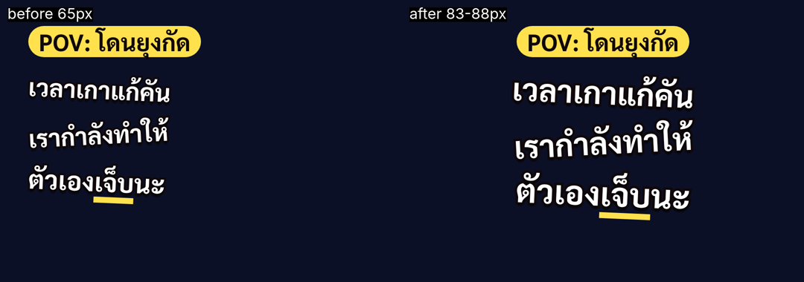

# dev v3.7 (2026-11-28): กล้องตามจังหวะตัด, หัวข้อเฟรม 0, คัตแข็ง + zoom punch, เครื่องมือจากตอน itch / caffeine-ranking / never-colonized

ห้อง dev (ลูกของห้องวางแผน Creative #4) branch `claude/dev-pending-rules-2` ต่อจาก 643253b (style.md feedback ผู้ใช้ยังอยู่ ไม่ได้แตะ)
ยังไม่ merge เข้า stoic-cray (รอห้องตรวจ)

| ข้อ | commit | ทำอะไร | ไฟล์ |
|---|---|---|---|
| 1 กล้อง | `f47faa7` | ทุกช็อตขยับตามความยาวจริงของช็อต (เดิมเร็วเฉพาะ hook/twist ที่เหลือ push 8% แบบ smootherstep ที่นิ่งทั้งต้นและท้ายช็อต) | `templates/brainrot-v3/build_index.py` (`camera()`), `index.html.tpl`, `TEMPLATE.md`, style.md Motion, editing-v3.md |
| 2 หัวข้อเฟรม 0 | `9420139` | pov ไม่ชิดซ้ายแล้ว (กลางจอเหมือน opening อื่น), tilt บรรทัด 1.26 (ไม่มีแถบไฮไลต์), แถบ pov ถึง ~Y 790 → หัวข้อ itch 65 → 83-88 px กลางจอ; เทสต์ FAIL ทุกคู่ opening×cover ที่เล็กกว่า 72/60 px **บนจอจริง** หรือไม่อยู่กลาง | `build_index.py` `title()`, `index.html.tpl`, `tests/browser/title_fit.js`, `tests/test_title_fit_v3.py`, `tests/test_build_index_v3.py`, style.md ตารางตำแหน่ง |
| 3 .hyperframes | `ef77ecf` | `.hyperframes/` ใน .gitignore ของรีโป + brainrot-v2/v3; เลิก track cache ของแม่แบบ v2 (ไม่แตะ projects/ ตอนอื่น) | `.gitignore`, `templates/brainrot-v{2,3}/.gitignore` |
| 4 ภาพนิ่ง action_at | `cdc8a9a` | src ภาพนิ่ง (.jpg/.png/.webp/.gif/.avif) → ข้าม action_at พร้อม INFO ไม่ ERROR; footage.md: ภาพนิ่งเขียนแค่ src | `tools/shot_times.py`, `.claude/agents/footage.md`, `tests/test_shot_times.py` |
| 5 จับเวลาบท | `564e3ff` | 12-13 → **11.9 ตัวอักษร/วิ** (20-40 วิ ≈ 240-475 ตัว); เช็กลิสต์ reviewer 15 → 11.9; "15 ตัว/วิ" ของคลิปตัวอย่างระบุว่าเป็นของเขา | `channels/knowledge/style.md`, `.claude/skills/make-clip/SKILL.md` ขั้น 3 |
| 6 + 8b footage_search | `19c109d` | ล็อกไฟล์ทั้งคำสั่ง `search`: ตัวที่สองขึ้น `WAIT ... (parallel search = 429)` แล้วรอคิว (`FOOTAGE_LOCK_WAIT` 600 วิ, เกิน = exit 3); note ใน SEARCH.json = บรรทัด `BLOCKED 429 ...` ของ get.sh (+ จำนวนครั้ง) แทนบรรทัดท้ายของ body ข้อผิดพลาด, แถว skipped บอกเหตุ, `_blocked_why` | `tools/footage_search.py`, footage.md, make-clip ตารางปัญหา, `tests/test_footage_search.py` |
| 7 sound_pass_vo mono | `f20b3dc` | vo mono ถูกก๊อปเป็นสเตอริโอก่อนวัด = +3 LU → WARN ผิด; ตอนนี้เช็ก -18 จากไฟล์ mono เอง ส่วนระยะเพลงใต้เสียงยังเทียบในมิกซ์สเตอริโอ | `tools/sound_pass_vo.py`, `tests/test_sound_pass_vo.py` |
| 8a คอมเมนต์ | `f4c1a8a` | "frame 0 = cover" → หัวข้อเฟรม 0 = cover_text, ปกที่อัปแยก (cover.html) | `build_index.py`, `index.html.tpl` |

## ข้อ 1 กล้อง: กฎใหม่
`camera(d, beat, i)` จากความยาวช็อตจริง d (สอดคล้อง style.md ข้อ 4 "จังหวะตัดแล้วแต่คลิป": ตัดถี่ = กล้องเร็วเอง)
- push 10-17% ยิ่งช็อตสั้นยิ่งเร็ว: 1 วิ ≈ 10%/วิ, 2 วิ ≈ 6.5%/วิ, 4 วิ ≈ 4.3%/วิ
- ออกตัวแรง 2.2 เท่าของความเร็วเฉลี่ยตรงจุดตัด (จังหวะ "ตึก" ตามคัต) แล้วผ่อน แต่ไม่ต่ำกว่า 40% จนคัตถัดไป
- แพนขึ้น/ลง 24 px + หมุน ±0.6° สลับทิศทีละช็อต + ส่าย sin/cos 10 px ที่ไม่หยุดพร้อมกัน (แบบ brainrot v2 7b088c8)
- hook/twist push ×1.3 ส่าย 14 px; scale เริ่ม 1.04 (1.06 เร็ว) ไม่เห็นขอบภาพ (เดิม hold เริ่ม 1.0 + หมุน = มุมภาพโผล่ เห็นในแถบภาพด้านล่าง); เพดาน 1.22
- ช็อตแรก (hook ภาพนิ่ง) และ loop คงเดิม (เฟรมสุดท้าย = เฟรม 0)

วัดเทียบ (timeline ตอน itch 21 ช็อต 37 วิ ใส่ภาพทดสอบทุกช็อต ซ่อนหัวข้อ/ซับ วัดค่าเฉลี่ย |Δluma| ต่อเฟรมที่ 30 fps ไม่นับ ±0.15 วิรอบคัต):

| | ก่อน (v3.6) | หลัง (v3.7) |
|---|---|---|
| เฟรมเกือบนิ่ง (< 0.6) | 47 | **0** |
| ค่ากลาง / เปอร์เซ็นไทล์ 10 | 1.73 / 0.78 | 1.98 / 1.17 |
| ช็อตสั้น < 1.5 วิ เฉลี่ย / ต่ำสุด | 2.71 / 1.23 | 2.60 / 1.49 |
| ช็อตยาว ≥ 2 วิ เฉลี่ย / ต่ำสุด | 1.55 / 0.59 | 2.07 / 1.19 |

ช็อตสั้นยังเคลื่อนมากกว่าช็อตยาว (2.60 เทียบ 2.07) ช็อตสั้นเฉลี่ยใกล้ของเดิมเพราะ push 8% ตายตัวเดิมเร็วอยู่แล้วบนคัตต่ำกว่า 1 วิ; สิ่งที่เปลี่ยนคือไม่มีจุดนิ่งตรงคัตอีก และช็อต 2-3 วิไม่ช้าแล้ว
ตัวตรวจ `tools/contact_sheet.py` (DIFF 0.005) ไม่เจอเฟรมนิ่ง > 0.5 วิทั้งสองแบบ: เกณฑ์ของมันหยาบเกินจะจับอาการ "ช้าตรงคัต"

| ช็อต | beat | วิ | ก่อน เฉลี่ย / ต่ำสุด | หลัง เฉลี่ย / ต่ำสุด |
|---|---|---|---|---|
| hook | hook | 2.14 | 0.94 / 0.74 | 0.94 / 0.74 |
| hook_in | hook | 1.36 | 2.64 / 1.19 | 3.1 / 1.63 |
| mosquito | setup | 1.16 | 2.88 / 1.32 | 2.65 / 1.59 |
| mast | setup | 2.68 | 1.2 / 0.33 | 1.84 / 1.17 |
| nerve | explain | 2.24 | 1.51 / 0.39 | 2.0 / 0.85 |
| signal | explain | 1.08 | 2.97 / 1.55 | 2.69 / 1.54 |
| spine | explain | 0.88 | 3.63 / 2.25 | 3.12 / 1.96 |
| brain_cmd | explain | 1.4 | 2.28 / 0.67 | 2.41 / 1.34 |
| scratch2 | explain | 1.96 | 1.63 / 0.45 | 2.15 / 1.38 |
| pain_cover | explain | 2.08 | 1.56 / 0.44 | 1.9 / 1.13 |
| temp | explain | 1.34 | 2.36 / 0.7 | 2.47 / 1.52 |
| mouse | explain | 2.12 | 1.52 / 0.42 | 1.99 / 1.08 |
| serotonin | reveal | 2.74 | 1.22 / 0.33 | 1.93 / 1.15 |
| serotonin2 | reveal | 1.62 | 1.96 / 0.54 | 2.18 / 1.1 |
| boost | twist | 2.3 | 1.84 / 1.22 | 2.24 / 1.06 |
| cycle | twist | 2.04 | 1.98 / 1.31 | 2.65 / 1.73 |
| contagious | share | 2.16 | 1.57 / 0.44 | 2.09 / 1.26 |
| watch | share | 1.28 | 2.5 / 1.21 | 2.36 / 1.26 |
| follow | share | 2.06 | 1.55 / 0.42 | 2.02 / 1.26 |
| cta | cta | 1.48 | 2.33 / 0.89 | 2.53 / 1.2 |
| loop | loop | 0.88 | 2.02 / 1.74 | 2.02 / 1.74 |

ตัวเลขในตารางบนวัดตอนมีแค่ข้อ 1 (กล้อง) หลังเพิ่มข้อ 18 (คัตแข็ง + zoom punch) วัดซ้ำได้: ค่ากลาง 2.03, p10 1.13, เฟรมเกือบนิ่ง 0,
ช็อตยาวเฉลี่ย 2.58 (รวม punch) — กราฟ/GIF ด้านล่างเป็น**ฉบับสุดท้าย** (ข้อ 1 + 18)

เส้นเทา (ก่อน) เริ่มจากเกือบ 0 ทุกคัตแล้วค่อยเร่ง = เห็นเป็นภาพค้างตรงจุดตัด; เส้นแดง (หลัง) พุ่งตรงคัตแล้วผ่อน
- ภาพเคลื่อนไหวก่อน/หลัง 4.5-10.5 วิ: `review-assets/v3.7/camera-before-after-4.5-10.5s.gif`
- แถบ 8 เฟรมของช็อต hold 2.68 วิ: `review-assets/v3.7/camera-hold-shot-strip.jpg` (แถวบนเห็นมุมภาพโผล่ซ้ายบนในเฟรมแรก)
- วิธีเรนเดอร์ตัวอย่าง: Playwright seek `window.__timelines.main` ทีละ 1/30 วิ (gsap จาก npm เพราะ proxy บล็อก jsdelivr) ไม่ใช่ `hyperframes render`; ไม่ได้ใช้ footage จริงของตอน itch (assets ไม่อยู่ใน git)

## ข้อ 2 หัวข้อเฟรม 0

- **ข้อเท็จจริงที่เจอ:** แม่แบบเดิมให้หัวข้อ itch 3 บรรทัด **65 px** CSS (ไม่ใช่ ~30) ผ่านเกณฑ์เดิม 60 px สำหรับ 3 บรรทัด แต่ดูเล็กเพราะ (1) pov ชิดซ้าย ใช้ความกว้างแค่ ~390 จาก 960 px
  (2) ความสูงถูกจำกัด: บรรทัด 1.42 + ช่องว่าง tilt 30 px + kicker ในแถบ Y 250-750. เลข ~30 px น่าจะมาจากการดูภาพตัวอย่างย่อครึ่ง ฟอนต์ Sarabun เองไม่ได้เล็กกว่าฟอนต์อื่น (วัด ก สูง 0.59 em เทียบ Kanit 0.55)
- หลังแก้: itch = 83/83/88 px กลางจอ ทุกคู่ opening×cover ของหัวข้อ itch: 65-100 px (card ยังเล็กสุด 65-69 เพราะขอบการ์ด)
- เทสต์: `test_frame0_title_every_opening_cover_itch_regression` (ไม่ใช้เบราว์เซอร์: ทั้ง 12 คู่ ≥ 60 px, pov/tilt ≥ 80, ไม่มี left-align) + `title_fit.js` (4 ฟอนต์ × 3 ปก × 4 เปิด × 5 หัวข้อ: ขนาด**บนจอ**ที่เฟรม 0 = font-size × transform ≥ 72/60, ทุกบรรทัดและ kicker อยู่กลาง X 540 ±40, หมึกสระบนไม่ทับบรรทัดบน)
- midstory+tilt คง line-height 1.42 (ลองแล้ว 1.26 สระบน Sarabun แตะแถบบรรทัดบน)

## เทสต์
`python3 -m pytest -q tests`: **125 passed, 0 skipped** (ฐาน 110 passed 1 skipped; skipped เดิม = sound_pass_vo ที่ข้ามเมื่อไม่มี librosa ห้องนี้ติดตั้ง librosa แล้วรันจริง; ข้อ 1-8 +6 เทสต์, ข้อ 9-18 +8 เทสต์ (test_timing.py มี 2))
เทสต์ใหม่: ข้อ 1 `test_camera_speed_follows_real_shot_length`, ข้อ 2 (ด้านบน), ข้อ 4 `test_still_image_action_at_skipped_not_error`, ข้อ 6/8b `test_searches_run_one_at_a_time` + `test_blocked_note_shows_the_429_not_the_error_body`, ข้อ 7 `test_mono_voice_at_minus_18_is_not_warned` (โค้ดเดิม: รายงาน -15.0 + WARN; ใหม่: -18 ไม่ WARN)

## ข้อ 9-18 (ห้องวางแผนส่งเพิ่ม จากห้อง caffeine-ranking / never-colonized)

| ข้อ | commit | ทำอะไร | ไฟล์ / เทสต์ |
|---|---|---|---|
| 9 ภาพหลักค้าง | `ec7f4ec` | `contact_sheet.py make` ย่อทุกเฟรมเป็นตารางสี 9x16 ตัดแถบซับ (Y 55-73%) ออก เทียบกับเฟรมแรกของภาพนั้น ต่างไม่ถึง 25 = ภาพเดิม (วัดจากภาพจริง: push 1.04→1.21 = 5-24, ตัดภาพ = 41-54) → `main_holds` + หัวข้อใน INDEX.md; `verify` พิมพ์ `WARN main picture held` ช่วง > 3 วิ (WARN ไม่ใช่ FAIL: แผนภาพยาวตั้งใจได้ reviewer.md บอกวิธีจด) ตัวอย่าง itch ไม่มี WARN เท็จ | `tools/contact_sheet.py`, reviewer.md / `test_main_picture_held_warns_even_if_small_things_move` (แถบสี 7 วิ + กล่องเล็กขยับ + แถบซับขยับ = WARN 0-7 วิ) |
| 10 ปกพื้นเข้ม | `b7b2476` | `look.json` `cover_palette`: pick ใส่ให้ (= palette ถ้าเข้ม, ไม่งั้น palette เข้มที่ไม่ได้ใช้นานสุด ไม่ซ้ำปกตอนก่อน); check: ปกสว่าง = WARN (`--final` ERROR), ซ้ำปกตอนก่อน/ชื่อไม่มี = ERROR; `cover_shot.js` ใช้ `cover_palette` | `tools/look.py`, `tools/cover_shot.js`, style.md 9a, TEMPLATE.md / `test_cover_palette_dark_even_when_the_look_is_light` + เรนเดอร์ปกจริงในเบราว์เซอร์ (look mint-paper + ปก night-violet = พื้นมืด) |
| 11 timing.md | `d39bf62` | `tools/timing.py` จับคู่บท (`script-vo-<lang>.txt` / `vo-<lang>-tts.txt`) กับ words.json ทีละตัวอักษร (difflib) → เริ่ม/จบ/ยาวทุกบรรทัด, แถวที่ถอดไม่ตรงบท = ≈, ช่วงเงียบ > 0.4 วิ; voice.md: ห้ามพิมพ์เวลาเอง | `tools/timing.py`, voice.md / `tests/test_timing.py`; ลองกับ transcript ตอน itch ได้ 21 บรรทัดตรง |
| 12ก ดูเฟรม footage | `ee4b7e5` | make-clip ขั้น 5: ผู้กำกับดูเฟรมทุกไฟล์ footage (contact_sheet / Read) ว่าตรงความหมายก่อนส่ง editor | make-clip |
| 12ข ต้นฉบับตัวเลข | `ee4b7e5` | **เลือก: researcher ไม่มี Bash ต่อไป** (อ่านหน้าเว็บที่คุมไม่ได้ทั้งวัน ถ้ามี Bash ข้อความแฝงในเว็บสั่งรันคำสั่งได้) → ตัวเลขหลักสุขภาพ/กฎหมาย/การเงินที่เปิดไม่ได้ติด ⚠️ + ลิงก์ ผู้กำกับ (มี Bash อยู่แล้ว) เปิดเองด้วย `tools/get.sh` แล้วจด "ผู้กำกับเปิดยืนยันแล้ว"; แก้ researcher.md ที่เคยบอกให้ใช้ get.sh ทั้งที่ไม่มี Bash | make-clip ขั้น 2, researcher.md |
| 12ค report ไม่นับ 429 | `6e2bd57` | `footage_search.py report` นับคำ/ชนิดเฉพาะการค้นที่แหล่งตอบจริง (ok) 429/blocked/skipped ไม่นับ | `test_report_does_not_count_blocked_or_skipped_searches` |
| 13 topic_exception | `55cd445` | `pacing.py`: หัวข้อจบหลัง 1.5 วิ + `"topic_exception": "<เหตุผล>"` (≥10 ตัว) = INFO; เหตุผลสั้น/ว่าง = FAIL; หาหัวข้อไม่เจอ = FAIL; ข้อความ FAIL บอกชื่อฟิลด์ | `tools/pacing.py`, style.md ข้อ 1 / `test_topic_exception_turns_late_topic_into_info` |
| 14 จำนวนรวม | `54401d0` | เช็กลิสต์ style.md + reviewer 1b: คลิปจัดอันดับ จำนวนรวม/คำเหมารวมต้องมีแหล่งที่นับแบบเดียวกัน ไม่มี = 🔴 | style.md, reviewer.md |
| 15 แผนที่ | `ef1bec8` | วง/ลูกศรครอบเฉพาะพื้นที่ที่พูดถึง (ไม่แน่ใจ = ลูกศร); ดินแดนพิพาท/ที่เสีย = ลายขีด + "พื้นที่โดยประมาณ" ห้ามระบายประเทศอื่นสีไทย | style.md 9a |
| 16 เพลงสำรอง | `f6b304a` | Openverse 429 → โหลดตรง Jamendo `prod-1.storage.jamendo.com/?trackid=<id>&format=mp31` ผ่าน get.sh เฉพาะ track ที่ยืนยันไลเซนส์ CC BY/CC0 แล้ว + จดเครดิต; ห้าม Mixkit/ยืนยันไม่ได้ | voice.md, make-clip ตารางปัญหา (ไม่ได้ทดลองโหลดจริง) |
| 17 Smithsonian | `69dd0a6` | แหล่งที่ 6 ใน `footage_search.py`: ภาพนิ่งเท่านั้น คำอังกฤษเท่านั้น CC0 ทั้ง record และไฟล์ภาพ, ใช้ High-resolution JPEG (ไม่เอา .tif), เครดิต = ชื่อพิพิธภัณฑ์ + ลิงก์ record; คีย์ = network secret ที่ proxy ใส่ (โค้ดส่งค่าแทนที่ `proxy-injected`, ไม่มีคีย์ใน repo); กฎ 429/ห้ามขนานเหมือนแหล่งอื่น; ทดสอบจริงผ่าน proxy ได้ภาพ CC0 | `tools/footage_search.py`, footage.md, make-clip / `test_smithsonian_cc0_stills_only` (mock) |
| 18 คัตแข็ง + punch | `01573b2` | `cut_kind()`: เปลี่ยนช่วงเรื่อง/hook/twist = ทรานซิชันของ look (look.py ยังสุ่ม), ในช่วงเดียวกัน = **คัตแข็ง** (เดิมครอสเฟด 0.1 วิ), loop = match; zoom punch สูตร v2 (ปรับให้ ≥ 0 ภาพไม่หดจนเห็นขอบ) ตรงซับ `*คำสำคัญ*` หลัง hook ห่าง ≥1.5 วิ (`episode.json` `"punch": "off"` / รายการซับ) — itch: 12 punch ใน 37 วิ, ไม่มีขอบโผล่ทั้ง 1110 เฟรม | `build_index.py`, `index.html.tpl`, TEMPLATE.md, style.md / `test_hard_cuts_inside_a_beat_and_zoom_punch_on_key_words` |

การตัดสินจากห้องวางแผน: (ก) หัวข้อ 83-100 px พอ ไม่ดันถึง 116 ✔ (ข) คัตแข็ง + zoom punch = ข้อ 18 ✔

## ที่ทำไม่ได้ / ข้อสังเกต
- หัวข้อไม่ถึง 116 px แบบที่ editor แก้มือในตอน itch (~85 px) — ห้องวางแผนตัดสินว่าพอแล้ว
- ไม่ได้ยกเกณฑ์ขั้นต่ำเกิน 72/60 (cover card 3 บรรทัดได้ 65 px จะ FAIL ทันที)
- ข้อ 18 punch เลือกจากซับที่ไฮไลต์อัตโนมัติ ถ้าตอนไหนไฮไลต์เยอะ/คำไม่สำคัญจริง editor ควรใส่ `"punch": [...]` เอง
- ข้อ 9 เกณฑ์ 25 วัดจากภาพถ่ายจริง 3 ภาพ + ตัวอย่าง itch; กราฟิกพื้นเรียบที่เปลี่ยนเลย์เอาต์เล็กน้อยอาจถูกนับเป็น "ภาพเดิม" (เป็น WARN ให้ reviewer ตัดสิน)
- ข้อ 16 ไม่ได้ทดลองโหลด Jamendo ตรงในห้องนี้ (เขียนตามที่ห้อง never-colonized ใช้ได้)
- ไม่ได้เรนเดอร์ด้วย hyperframes CLI / footage จริง (ตัวอย่างใช้ภาพทดสอบ); ห้องทำตอนถัดไปควรดู contact sheet ของคลิปจริง
- ไฟล์ `.hyperframes/` ที่ track อยู่ใน projects/2026-11-17-knowledge-nature ไม่ได้ลบ (ห้ามแตะ projects/ ตอนอื่น) .gitignore ใหม่ไม่มีผลกับไฟล์ที่ track แล้ว

## ปิด 🟡 จากห้องตรวจ (docs/review-v3.7-2026-11-28.md บน claude/review-v3.7-2026-11-28 @52454f0: "รวมได้ ไม่มี 🔴")

| ข้อ | commit | แก้อะไร | เทสต์ |
|---|---|---|---|
| 🟡1 pick ปกซ้ำ | `0dae5c2` | look.py pick: palette เข้มที่ = ปกตอนก่อน → เลือก cover_palette เข้มอื่น (เดิม copy palette ตรงๆ check ตกเอง 5/40) | `test_pick_never_repeats_previous_cover_palette_and_passes_check` ทุก palette × ปกตอนก่อน (โค้ดเดิม FAIL) |
| 🟡2 Smithsonian 0 ผล | `2d8691b` | ใส่ `AND media_usage:"CC0"` ใน q (ลองจริง: coffee/cat ได้ผล) | mock ตรวจว่า query มีเงื่อนไขนี้ |
| 🟡3 id เป็น URL | `90c4e80` | `si_slug()` ทำ id ปลอดภัยเป็นชื่อไฟล์ (ark/URL/download?id/media:) ≤48 ตัว `[A-Za-z0-9_-]` | ทดสอบ URL, ark, `../../etc/passwd`, None |
| 🟡4 ห้าม Mixkit | `c6c5144` | manifest ลบ Mixkit runtime 40 รายการ, เสียง typing ในชุดหลักเปลี่ยนเป็น CC0 Freesound (j1987 #79388) ที่อยู่ในคลัง; `sound_pass.py` + `sound_pass_vo.py` ปฏิเสธเพลง/ไลเซนส์/swap/URL ที่เป็น Mixkit และนับเฉพาะ CC0 ว่าไลเซนส์ฟรี; MUSIC.md เขียนใหม่ (เพลง = look.json music_file เท่านั้น, Jamendo/Wikimedia CC BY/CC0 ที่ยืนยันแล้ว); SKILL/README/TOP-PICKS/LICENSES, editor.md, make-clip | `test_no_mixkit_anywhere_in_the_sound_kit` (manifest + ชุดหลักมีไฟล์ CC0 จริง + มิกซ์ปฏิเสธ Mixkit) |
| 🟡5 punch ทับคัต | `89ca23c` | ไม่ punch ใน 0.3 วิแรกของช็อตที่เพิ่งเข้า (คัตหรือทรานซิชัน) | ฟังก์ชัน punches() + ข้อมูลที่ build ออกมา |
| ⚪ | `73e9dc1`, `c7a9c0e` | editing-v3.md แถว push 8%/ครอสเฟด หมายเหตุ "แทนที่ใน v3.7"; punch ≤8 ครั้งต่อคลิปกระจายทั้งคลิป + แรง 6-10%/ความยาวต่างกันตาม look | ทดสอบใน test_hard_cuts... |

pytest: **127 passed, 0 skipped**. ตัวอย่าง itch ด้วยแม่แบบสุดท้าย: 8 punch (amp 0.09), ขอบภาพไม่โผล่ทั้ง 1110 เฟรม
